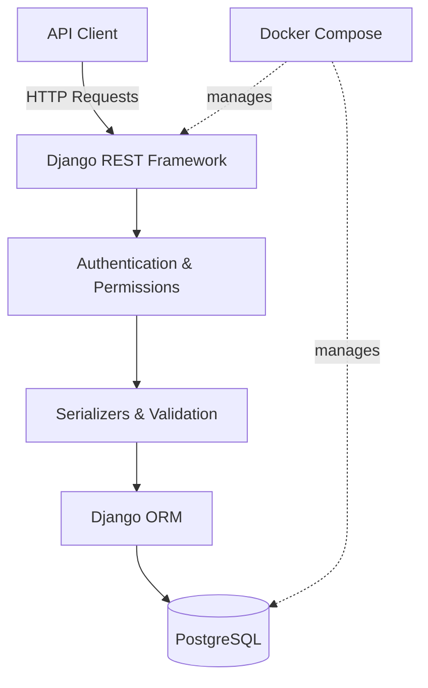

# 🍳 Recipe App API

<p align="center">
  A RESTful API for managing recipes, built with Django REST Framework, PostgreSQL, and Docker.
</p>

<p align="center">
  
  
  
  
</p>

## 📖 Overview

**Recipe App API** is a backend application designed to provide a structured REST API for recipe management. It uses Django REST Framework to handle API requests, PostgreSQL for persistent data storage, and Docker Compose to simplify the development environment.

The project focuses on building a maintainable backend with authenticated access, data validation, database integration, and automated testing.

## ✨ Features

- 🔐 **User-based access** — authenticated users can manage their own recipes.
- 📝 **Recipe management** — create, retrieve, update, partially update, and delete recipes, according to the implemented endpoints.
- 🔄 **RESTful API** — structured HTTP endpoints with appropriate status codes.
- 🗄️ **PostgreSQL integration** — relational database storage.
- 🐳 **Dockerized development** — run the application and database using Docker Compose.
- 🧪 **Automated tests** — test API behavior, permissions, and recipe updates.
- ⚙️ **Environment-based configuration** — configure the application and database for local development.

## 🛠️ Tech Stack

| Technology | Purpose |
|---|---|
| Python | Core programming language |
| Django | Backend web framework |
| Django REST Framework | REST API development |
| PostgreSQL | Relational database |
| Docker | Application containerization |
| Docker Compose | Multi-container development environment |
| Django Test Framework | Automated testing |

## 🏗️ Architecture



The API layer receives requests, validates input through serializers, applies authentication and permission rules, and interacts with PostgreSQL through Django's ORM.

## 🚀 Getting Started

### Prerequisites

Make sure you have the following installed:

- [Git](https://git-scm.com/)
- [Docker Desktop](https://www.docker.com/products/docker-desktop/)
- Docker Compose

You do not need to install Python or PostgreSQL directly on your machine to use the Docker-based development setup.

### 1. Clone the repository

```bash
git clone https://github.com/YOUR_USERNAME/recipe-app-api.git
cd recipe-app-api
```

Replace `YOUR_USERNAME` with your GitHub username.

### 2. Start the application

Build the image and start the services:

```bash
docker-compose up --build
```

If your Docker Compose installation uses the newer plugin syntax, you can use:

```bash
docker compose up --build
```

### 3. Run database migrations

In another terminal, from the project directory, run:

```bash
docker-compose run --rm app sh -c "python manage.py migrate"
```

### 4. Create a superuser (optional)

```bash
docker-compose run --rm app sh -c "python manage.py createsuperuser"
```

### 5. Run the test suite

```bash
docker-compose run --rm app sh -c "python manage.py test"
```

### 6. Stop the containers

```bash
docker-compose down
```

To remove the containers and their associated Compose network, use the command above. Add `-v` only if you intentionally want to remove the associated named volumes and their stored data.

## 🧪 Testing

The project uses Django's testing framework to verify API behavior.

Run the full suite with:

```bash
docker-compose run --rm app sh -c "python manage.py test"
```

Example areas to test include:

- Recipe creation and retrieval
- Full and partial updates
- Authentication and permissions
- Ownership of user-created recipes
- Serializer validation
- Expected HTTP response codes

## 📂 Project Structure

```text
recipe-app-api/
├── app/
│   ├── core/               # Shared models and application logic
│   ├── recipe/             # Recipe-related functionality
│   ├── user/               # User and authentication functionality
│   ├── manage.py
│   └── ...
├── Dockerfile
├── docker-compose.yml
├── requirements.txt
├── requirements.dev.txt
└── README.md
```

*Note: Adjust the directory names above to match your repository's actual structure.*

## 🔒 Security Considerations

- Keep secret keys and database credentials out of version control.
- Use environment variables or local-only settings for sensitive configuration.
- Apply authentication and object-level permissions to protected endpoints.
- Validate incoming data through serializers.
- Use production-specific settings before deploying publicly.
- Never expose development credentials or enable debug mode in production.

## 🗺️ Roadmap

Potential improvements for future development:

- [ ] Generate interactive API documentation with OpenAPI and Swagger UI.
- [ ] Add API filtering, searching, and pagination.
- [ ] Expand test coverage for authentication and permissions.
- [ ] Configure a production deployment workflow.
- [ ] Add automated linting and continuous integration.

## 🎯 Project Goals

This project is part of my backend engineering journey, with a focus on:

- Building production-minded REST APIs
- Understanding Django models, serializers, views, and permissions
- Working with relational databases
- Developing reproducible environments with Docker
- Writing reliable tests and maintainable backend code

## 👨‍💻 Author

**Amirhossein Aarabi**

- GitHub: [@amirhosseinaarabi2002](https://github.com/amirhosseinaarabi2002)

---

<p align="center">
  Built with Python, Django REST Framework, PostgreSQL, and Docker. 🐍
</p>
